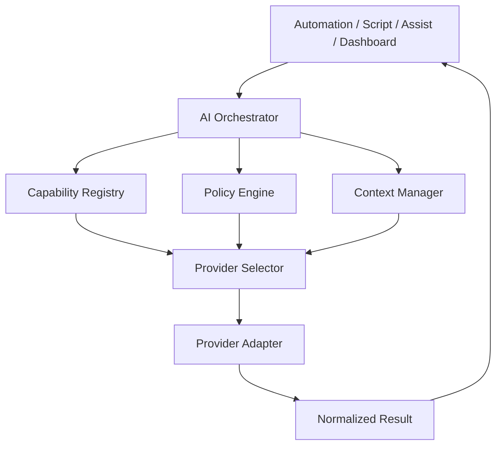

# AI Platform

## Status
Architecture contract for RC.15 Phase 4. Runtime provider adapters are planned.

The AI platform is provider-neutral and capability-driven.

## Goals

- provider independence;
- capability-based routing;
- local-first operation where practical;
- explicit privacy policy evaluation before dispatch;
- normalized, auditable results;
- Home Assistant-native service, event and automation integration.

## Architecture

## Non-goals
RC.15 does not claim working OpenAI, Claude, Gemini, Rekognition or local-model adapters. Provider names describe target contracts only.

## Related decisions
ADR-0050, ADR-0051, ADR-0052 and ADR-0053.
