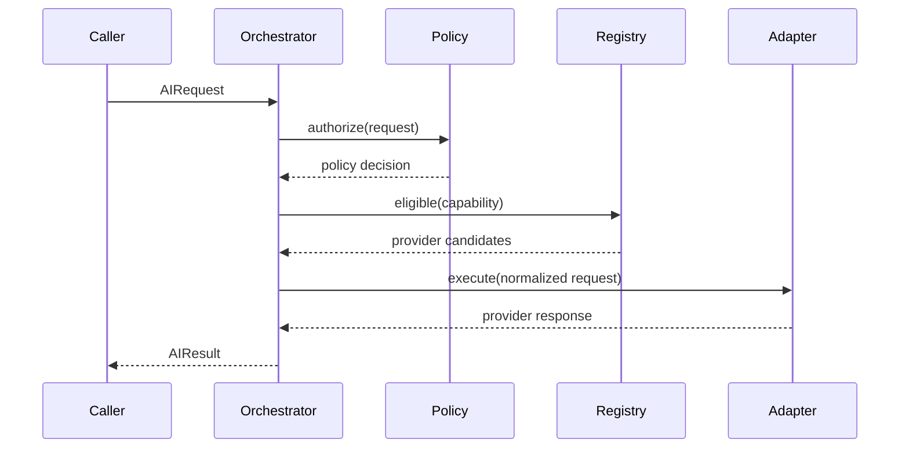

# AI Runtime

## Request lifecycle

1. Validate capability and payload.
2. Classify data sensitivity.
3. Enforce policy and consent.
4. Resolve eligible providers.
5. Select preferred provider and fallback order.
6. Apply timeout, retry and rate limits.
7. Normalize response and emit audit metadata.
8. Cache only when policy permits.

## Failure contract
Failures are typed as unavailable, unauthorized, timeout, quota, invalid response, unsupported capability or internal error. Fallback never bypasses privacy policy.
