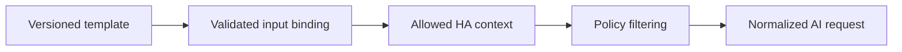

# Prompt Engine

Prompts are versioned templates with declared capability, inputs, output schema, privacy class and locale. Templates must avoid embedding credentials or raw Home Assistant secrets.

## Processing

Prompt changes that alter automation-visible output require schema versioning and release notes.
