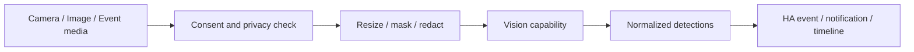

# Vision Pipeline

## Scope
Camera snapshots, image entities and externally supplied media may be analyzed for scene description, OCR and object detection.

Cloud upload requires explicit policy approval. Media retention and metadata retention are separate controls.
