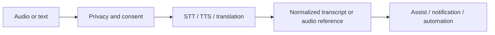

# AI Voice Pipeline

This document covers AI speech capabilities and complements the core voice pipeline.

Inputs may originate from Home Assistant Assist, door-station audio or automation text. The platform may request transcription, synthesis, translation or summarization.

Biometric voice identification is outside the initial contract.
