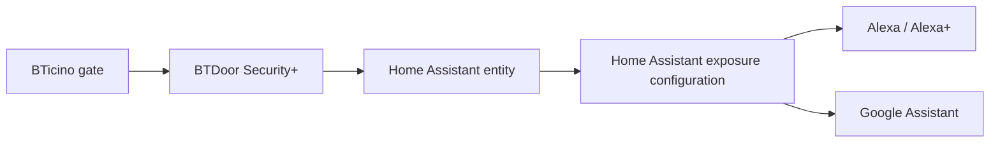

# Alexa, Alexa+ and Google Assistant Exposure

## Architecture

BTDoor Security+ does not implement a private Alexa or Google transport. Home Assistant exposes selected entities through Home Assistant Cloud or the corresponding manual assistant integration.

## Recommended surfaces

- Prefer the native `button` inside Home Assistant.
- Use the optional voice-bridge `switch` only where assistant discovery requires a switch-like surface.
- Do not expose diagnostics, identifiers or developer entities.
- Give the exposed entity an unambiguous spoken name.

## Security expectations

Alexa and Google apply their own device-type and secure-action rules. Secure-device commands may still use cloud paths even when some local fulfillment exists. Validate PIN, confirmation, household permissions and routine behavior on the actual assistant account before relying on voice control.

## Bidirectional boundaries

Commands from assistant to Home Assistant may activate exposed entities. Announcements or broadcasts from Home Assistant to assistant speakers require separate Home Assistant integrations/services and are not provided directly by BTDoor Security+.

## Alexa+

Alexa+ is treated as a distinct validation target. Compatibility inherited from Alexa entity discovery is not considered proven until tested on the intended account, locale and device generation.

## Validation checklist

1. Expose only the intended bridge entity.
2. Force a Home Assistant/Alexa/Google synchronization.
3. Verify the spoken name and room assignment.
4. Test success, rejection, unavailable device and multiple-gateway ambiguity.
5. Confirm audit events contain the expected `source` and `request_id`.
6. Document real-device evidence in the compatibility matrix.
