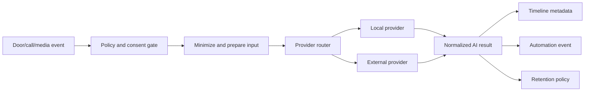

# AI Pipeline

**Status:** Planned architecture; no implicit provider activation

The AI pipeline is an extension boundary for local or external vision/language providers such as Home Assistant conversation agents, ChatGPT, Claude, Gemini and Amazon Rekognition. No media is sent externally without explicit configuration.

## Provider contract

Providers receive a bounded request and return normalized labels, confidence, text or structured analysis. Provider-specific payloads do not become the public automation API.

## Privacy requirements

- Explicit opt-in per provider and capability.
- Data minimization and configurable retention.
- No face identity database by default.
- User-visible indication when cloud processing is enabled.
- Redaction of provider credentials and request URLs.
- Ability to disable processing without breaking core door functions.

## Failure isolation

AI failures never block gate control, SIP registration, call journal or core entity updates. Results are advisory unless the user deliberately builds an automation around them.
