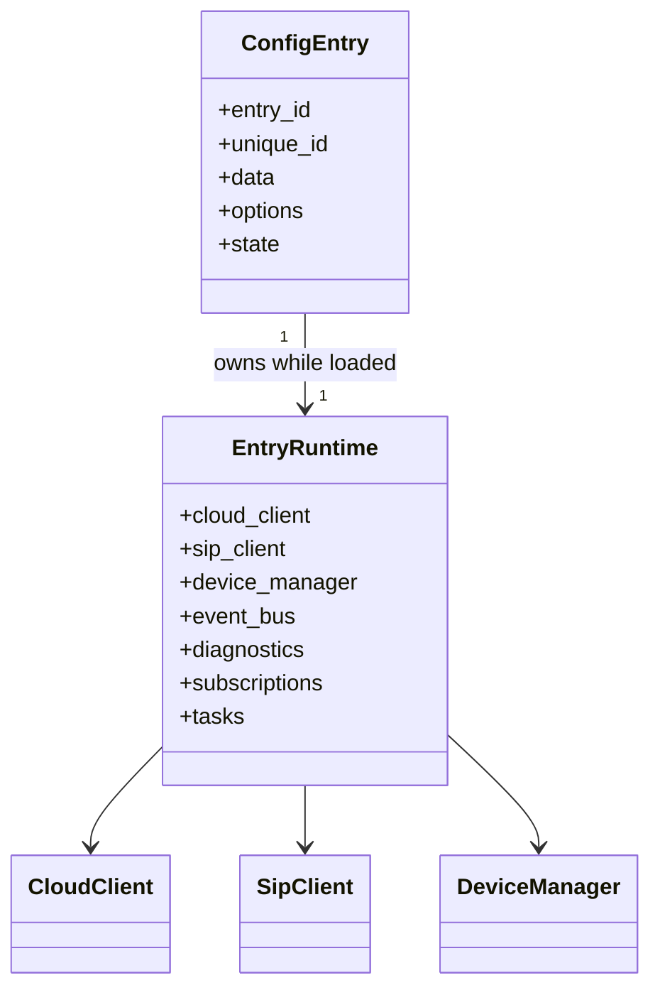

# Configuration Entry Model

**Status:** Active

A configuration entry represents one independently managed gateway or logical BTicino endpoint.

## Data versus options

- Immutable identity and credentials belong in config-entry data.
- User-tunable behavior belongs in options.
- Secrets are stored using Home Assistant config-entry storage and never copied to diagnostics.
- Options updates trigger a controlled reload when runtime construction changes.

## Unique identity

The entry unique ID must derive from stable remote identity, never a display name or network address that can change. Duplicate setup is rejected or mapped to the existing entry.

## Lifecycle

- `async_setup_entry`: create runtime, validate prerequisites, forward platforms.
- options listener: request reload.
- `async_unload_entry`: unload platforms, unsubscribe, cancel tasks, close clients.
- remove: delete entry-owned persistent artifacts where safe and documented.

## Multi-entry guarantees

Services accepting an optional `entry_id` must reject ambiguity when multiple entries exist. Entity-targeted calls resolve through the entity registry to the exact entry.
