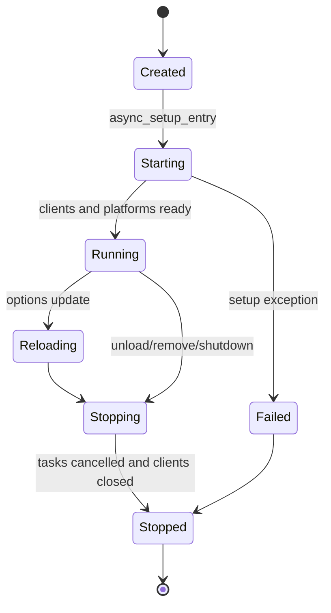

# Core Runtime

**Status:** Active

The core runtime is created per Home Assistant configuration entry and is the single owner of entry-local clients, task handles, normalized state and managers.

## Ownership rules

- One runtime per `ConfigEntry.entry_id`.
- Tasks are created through entry-owned lifecycle helpers and cancelled on unload.
- Event subscriptions return unsubscribe callbacks stored by the runtime.
- Cloud and SIP clients must not be module-level singletons.
- Mutable state exposed to entities is read through runtime providers or immutable snapshots.

## Runtime responsibilities

1. Create and validate clients.
2. Build device and entity source models.
3. Publish normalized events.
4. Maintain health and runtime summaries.
5. Register entry-local callbacks.
6. Release all resources idempotently.

## Failure behavior

Recoverable remote failures update health state and may trigger retry or re-authentication. Programming errors must not be silently converted into successful setup. Cleanup remains safe after partial setup.

## Implementation map

- `custom_components/btdoor_security_plus/core/runtime.py`
- `custom_components/btdoor_security_plus/core/lifecycle.py`
- `custom_components/btdoor_security_plus/runtime.py`
- `custom_components/btdoor_security_plus/runtime_state/`
- `custom_components/btdoor_security_plus/models/runtime.py`
