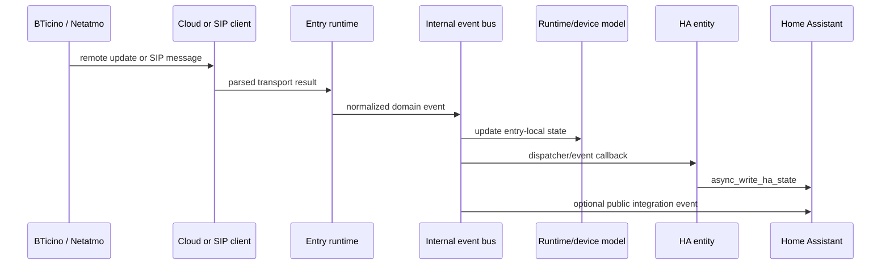
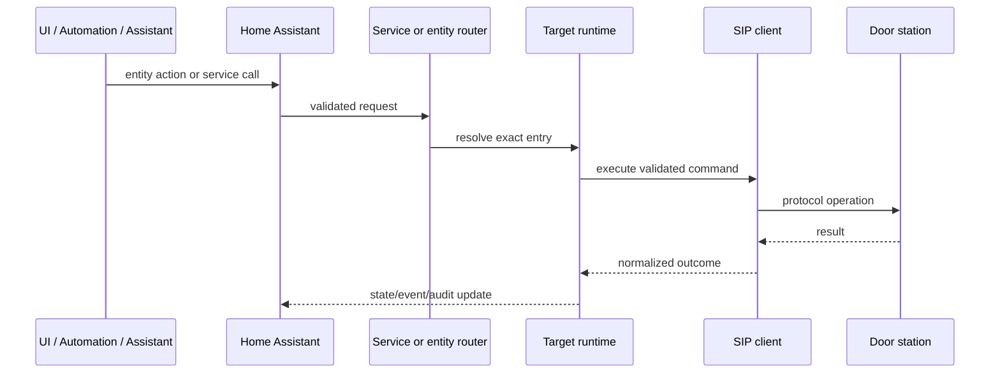

# Data Flow

**Status:** Active

## Inbound flow

1. Transport clients receive cloud or SIP data.
2. Parsers validate shape and normalize values.
3. Runtime converts transport data to domain events and models.
4. Entry-local subscribers update journal, timeline, diagnostics and entities.
5. Only explicitly supported events are published to Home Assistant.

## Action flow

## Data classification

| Class | Examples | Persistence rule |
|---|---|---|
| Public metadata | integration version, supported feature | may be documented/exported |
| Operational | connection status, counters, timestamps | persisted only when required |
| Personal | caller identity, images, audio, journal details | minimize and protect |
| Secret | tokens, private keys, certificate secrets | never log or export |

## Redaction boundary

All diagnostic and support outputs pass through `support_sanitizer.py`; producers must still avoid creating secret-bearing payloads.
