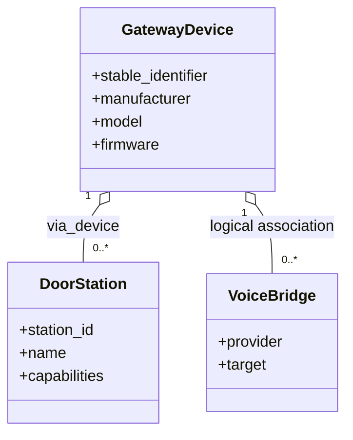

# Device Model

**Status:** Active

The device model converts discovered or configured endpoints into stable Home Assistant device-registry identities.

## Identity contract

- Identifiers use the integration domain plus stable remote IDs.
- Display names never participate in identity.
- Firmware is descriptive metadata and must reflect the loaded integration/device evidence, not a stale constant.
- Child devices use `via_device` only when a real registry hierarchy exists.

## Device kinds

The codebase models gateway, physical endpoint and logical bridge concepts. Exact supported kinds are defined in `models/device.py` and constructed through `device_model/factory.py`.

## Capability discovery

Entity creation follows capabilities, not product-name string matching. Unknown capabilities must be ignored safely and retained in diagnostics only when sanitized.

## Implementation map

- `device_model/factory.py`
- `device_model/manager.py`
- `device_model/names.py`
- `models/device.py`
- `managers/device_manager.py`
