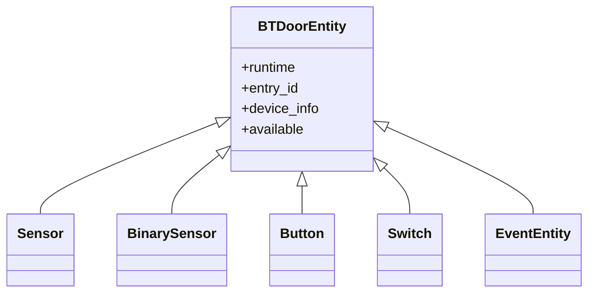

# Entity Model

**Status:** Active

Entities expose runtime capabilities through Home Assistant-native domains.

## Current platforms

| Domain | Purpose |
|---|---|
| `sensor` | counters, status details, diagnostics and metadata |
| `binary_sensor` | binary connectivity/call/certificate conditions |
| `button` | momentary gate and maintenance actions |
| `switch` | assistant bridge or persistent behavior toggles |
| `event` | transient normalized call/door events |

## Entity rules

- Unique IDs are stable and entry-scoped.
- Entity names are translated or derived from stable device names.
- Availability reflects the smallest meaningful dependency.
- Actions validate runtime state immediately before executing.
- Entities do not own network clients.
- Removal of an entity type requires migration and registry impact analysis.

## Update path

Entities receive changes from the runtime event bus/dispatcher and call `async_write_ha_state`; periodic polling is used only where the upstream source cannot push.

## Voice exposure

Security-sensitive actions are exposed through deliberate button/switch bridges and must follow the voice-assistant safety documentation. Exposure is never automatic solely because an entity exists.
