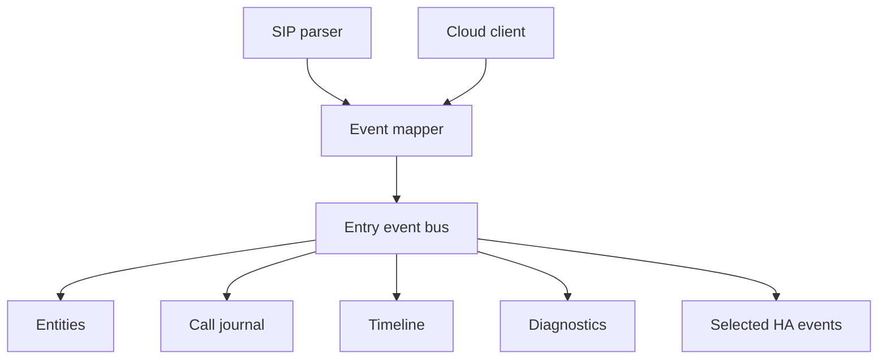

# Event Bus

**Status:** Active

The internal event bus distributes normalized entry-local events without coupling producers to consumers.

## Contract

- Publication is entry-scoped.
- Subscribers are registered and removed through lifecycle-managed callbacks.
- One failing subscriber must not prevent cleanup or corrupt the event bus.
- Event payloads are immutable by convention after publication.
- Public Home Assistant events are a curated subset, not a mirror of internal traffic.

## Ordering

Events generated by one parsed SIP message are published in deterministic order. Cross-transport ordering is best effort unless a correlation/timeline layer explicitly sequences it.

## Backpressure

Current processing is lightweight and in-process. Future high-volume media/AI events must use bounded queues and explicit drop/coalescing policy before implementation.
