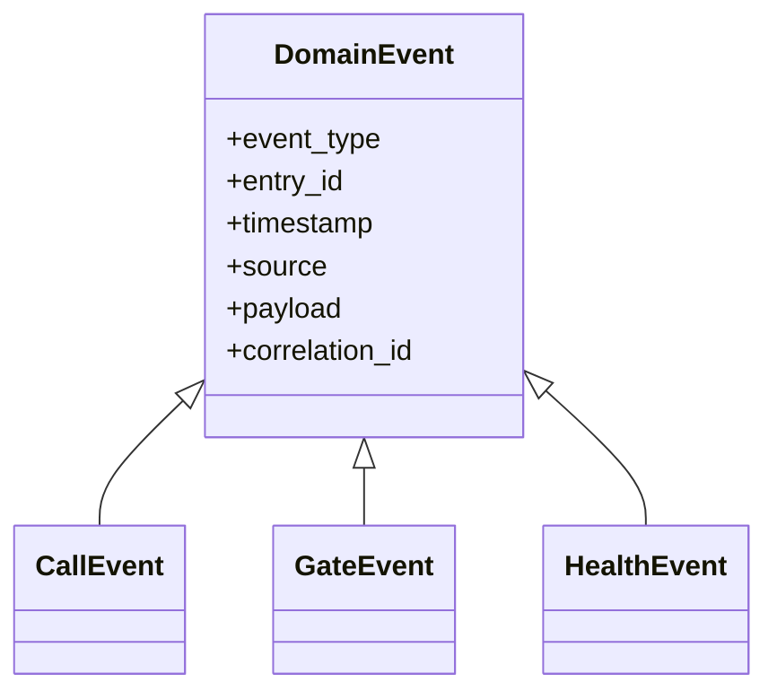

# Event Model

**Status:** Active

Events decouple transport parsing from entities, journal, diagnostics and automations.

## Event layers

- Transport events: parser/client-local, not public API.
- Domain events: normalized internal contract in `event_bus/events.py`.
- Home Assistant events: intentionally exposed public automation contract.
- Event entities: state-machine representation for selected transient events.

## Required fields

Every normalized event should carry entry identity and timestamp. Correlation IDs are recommended for multi-step call/dialog flows. Payloads must avoid credentials and raw private key/certificate material.

## Compatibility

Renaming or changing the semantics of a public event is an API change. Additive payload fields are preferred. Breaking changes require ADR, migration guidance, roadmap/changelog updates and compatibility tests.

## Implementation map

- `event_bus/bus.py`
- `event_bus/events.py`
- `event_bus/mapper.py`
- `event.py`
- `models/call.py`
- `models/sip.py`
