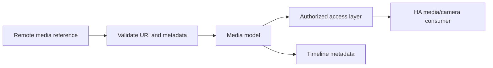

# Media Pipeline

**Status:** Partial / extension boundary

Current code provides media models and utilities, while full audio/video streaming is roadmap work.

## Implemented boundary

- Media metadata models: `models/media.py`.
- Media helper module: `media.py`.
- Call journal may reference sanitized media metadata.

## Planned boundary

Audio call control, voicemail and security camera streams are planned in roadmap 1.x. They must not be presented as currently supported until runtime modules and tests exist.

## Security requirements

- Never expose authenticated remote URLs directly in public `/local` paths.
- Apply explicit expiration to temporary access URLs.
- Keep binary media outside diagnostics bundles by default.
- Validate content type and size before processing.
- AI providers receive media only through explicit user configuration and privacy policy.
