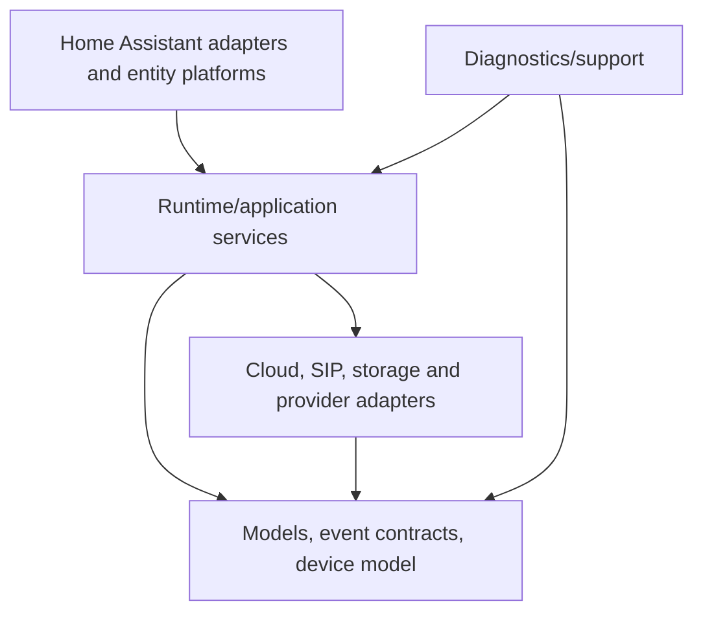

# Module Boundaries

**Status:** Active

| Boundary | May depend on | Must not own |
|---|---|---|
| `core/` | models, adapters, managers | Home Assistant entity instances |
| transport clients | models, parser helpers | entity registry or dashboards |
| `event_bus/` | event models | network clients |
| `device_model/` | normalized device models | cloud/SIP sessions |
| entity platforms | runtime APIs, HA entity APIs | client lifecycle |
| diagnostics | read-only runtime providers, sanitizer | credentials or destructive actions |
| UX/dashboard | entity metadata and HA storage APIs | protocol transport |
| future AI providers | normalized provider interface | gate-control authority |

## Dependency direction

Circular imports across these boundaries are architecture defects. Shared constants and immutable models should be moved downward rather than importing entity/platform modules into the runtime.
