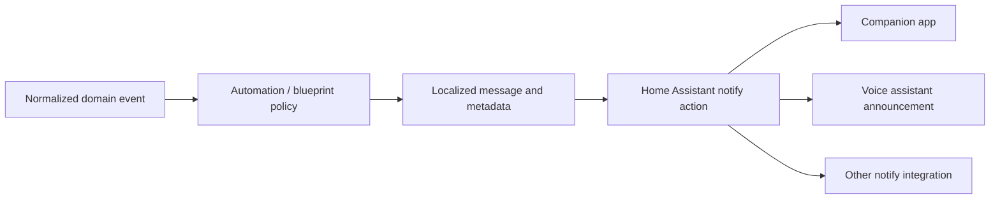

# Notification Pipeline

**Status:** Active for automation events; advanced notifications planned

BTDoor Security+ publishes state and events; Home Assistant automations and supplied blueprints decide when and where notifications are sent.

## Current assets

Blueprints cover incoming calls, missed calls, SIP offline state, certificate expiry and health score alerts.

## Requirements

- Notification delivery must not block the runtime event bus.
- User-visible text is localized by the automation/blueprint surface.
- Sensitive caller or media data is excluded unless explicitly selected by the user.
- Repeated connectivity alerts should use throttling or state-transition logic.

## Planned smart notifications

Roadmap 1.8 may add richer classification and actionable notifications. Any such feature must remain provider-neutral and privacy-aware.
