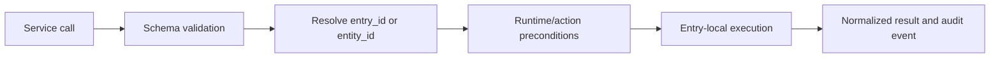

# Service Model

**Status:** Active

Services are global Home Assistant registrations routed to one or more entry runtimes.

## Current service groups

- Gate action: `open_gate`.
- Runtime maintenance: `reset_statistics`, `test_connection`, `reject_call`.
- Developer diagnostics: `developer_test`, `generate_support_report`, `export_debug_bundle`, `clean_debug_environment`.
- Journal management: `clear_call_journal`, `export_call_journal`, `rebuild_call_journal`.

The canonical user-facing schemas are in `services.yaml`; routing and implementation are in `services.py`.

## Routing rules

1. Prefer `entity_id` when it uniquely identifies the target entry.
2. Otherwise use explicit `entry_id`.
3. When neither is supplied, a single configured entry may be inferred.
4. Ambiguous destructive or physical actions must fail rather than broadcast.
5. Services documented as all-entry operations may iterate runtimes explicitly.

## Error contract

Invalid selectors, unavailable runtimes, disabled developer mode and transport failures return actionable Home Assistant service errors. Sensitive exception details are sanitized before user display or export.
