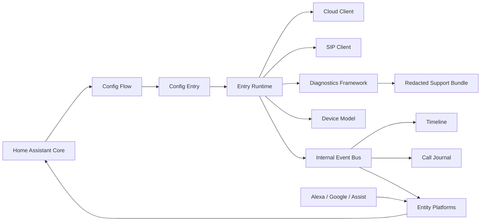

# System Architecture

**Status:** Active  
**Release:** 1.1.0-rc.15 Phase 2  
**Scope:** current integration runtime and documented extension boundaries

BTDoor Security+ is a Home Assistant hub integration that coordinates BTicino cloud discovery, certificate-backed SIP communication, devices, entities, diagnostics, call journal and safe assistant bridges. Each configuration entry owns an isolated runtime.

## Runtime boundary

The entry runtime is the ownership boundary for clients, tasks, subscriptions and entry-specific state. No entry may mutate another entry's runtime. Global service registration is permitted only when routing resolves a single target entry or explicitly operates on all entries.

## Implemented subsystems

| Subsystem | Primary modules | Responsibility |
|---|---|---|
| Setup and lifecycle | `__init__.py`, `core/lifecycle.py`, `core/runtime.py` | setup, unload, reload and cleanup |
| Cloud | `cloud.py`, `models/cloud.py` | discovery and cloud state |
| SIP | `sip_client.py`, `sip_identity.py`, `dialog/` | registration, calls and gate command transport |
| Eventing | `event_bus/`, `event.py` | normalized internal and HA-facing events |
| Device identity | `device_model/`, `managers/device_manager.py` | stable devices and hierarchy |
| Entities | `entity.py`, platform modules | Home Assistant representation and actions |
| Journal and timeline | `call_journal/`, `sip_timeline.py` | retained normalized history |
| Diagnostics | `diagnostic_framework/`, `diagnostics.py`, `support_*` | health, redaction and support evidence |
| UX | `ux/`, `managers/dashboard_manager.py` | optional dashboard-oriented metadata |

## External trust boundaries

- Home Assistant supplies configuration storage, registries, services and event APIs.
- BTicino/Netatmo cloud responses are untrusted external input.
- SIP messages and SDP are parsed as untrusted network input.
- Assistant commands are treated as requests, not proof of physical authorization.
- Support exports must pass the sanitizer before persistence.

## Related decisions

- ADR-0032 through ADR-0036 define platform direction.
- ADR-0042 defines the Repository Integrity Suite.
- ADR-0045 defines zero knowledge loss and continuity.
