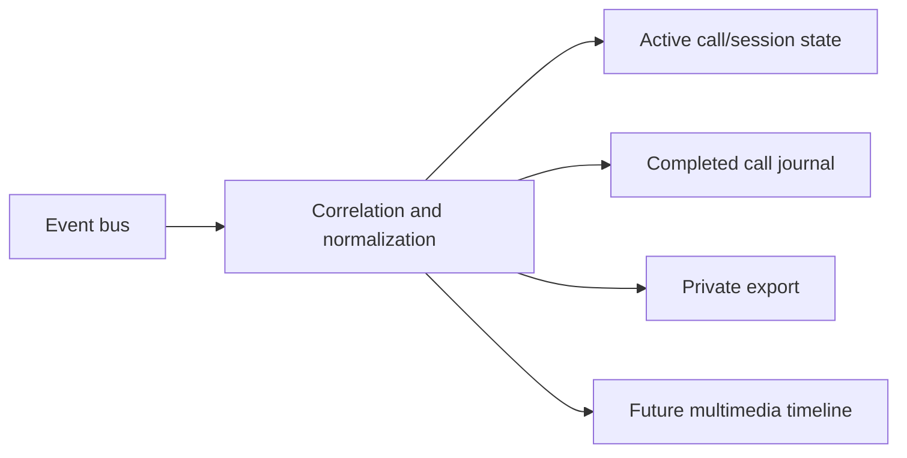

# Timeline Engine

**Status:** Partial / evolving

The timeline correlates normalized call, gate, health and future media/AI events into ordered records.

## Current implementation

- SIP timeline helpers: `sip_timeline.py`.
- Durable call records: `call_journal/journal.py`.
- Call models: `models/call.py`.
- Journal services: clear, export and rebuild.

## Record contract

Records use stable IDs, entry identity, timestamps, direction/state and sanitized metadata. Rebuild operations derive records only from retained normalized evidence and must be idempotent.

## Future evolution

Roadmap 1.6 expands the timeline with multimedia references. Binary media remains external to the core record and follows retention/privacy controls.
