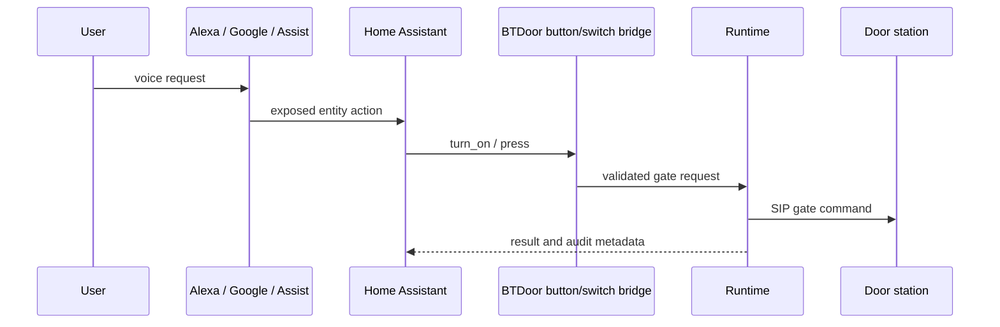

# Voice Pipeline

**Status:** Active bridge; native call audio planned

The current voice path converts assistant requests into safe Home Assistant entity/service actions. It does not yet implement full duplex door-station audio.

## Safety rules

- Exposure to assistants is opt-in and documented.
- The bridge does not bypass Home Assistant authorization.
- Ambiguous multi-entry targeting fails closed.
- Physical-action requests include source/reason metadata where supported.
- Lock-like semantics must not be claimed unless the device reports lock state.

## Future audio calls

Roadmap 1.4 introduces audio and call control. That work requires codec negotiation, media lifecycle, echo handling, privacy controls and real-device validation.
