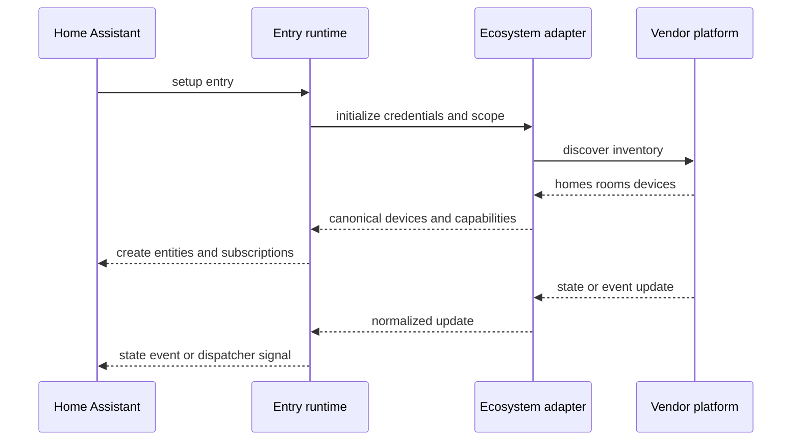

# Ecosystem adapter contract

## Required adapter responsibilities

An ecosystem adapter must:

- authenticate or connect without exposing secrets in logs or diagnostics;
- discover homes, rooms and devices;
- emit stable canonical identifiers;
- declare capabilities explicitly;
- normalize state and events;
- provide availability and health information;
- isolate each Home Assistant config entry;
- support unload and reauthentication cleanly;
- degrade safely when a transport is unavailable.

## Error categories

| Category | Runtime behavior |
|---|---|
| Authentication | trigger reauthentication; preserve entity registry |
| Rate limit | back off; retain last known state |
| Partial inventory | expose verified devices only; report diagnostics |
| Unsupported device | keep inventory metadata without creating false entities |
| Local transport loss | mark affected capabilities unavailable |
| Cloud transport loss | use local fallback only when semantics are equivalent |
