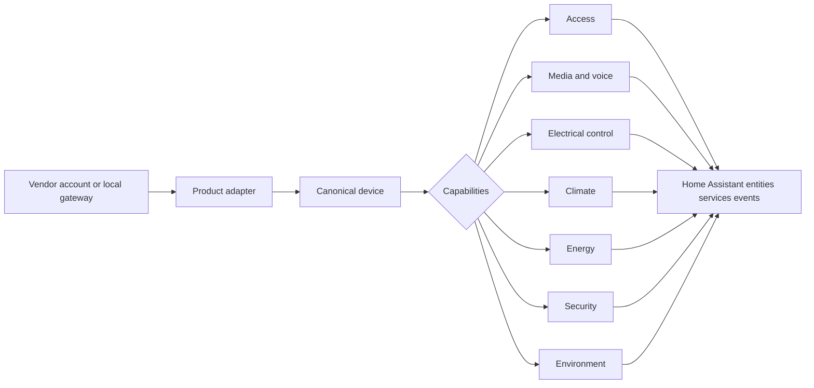

# Ecosystem capability model

## Purpose

Product names and transport protocols must not directly define Home Assistant entities. Adapters normalize vendor-specific devices into stable capabilities.

## Capability families

| Family | Examples | Typical Home Assistant surface |
|---|---|---|
| Access | gate relay, door relay, temporary access | button, switch, lock, event, service |
| Communication | call state, SIP identity, intercom | event, sensor, service |
| Media | snapshot, clip, stream, voicemail | camera, media source, event |
| Electrical | light, dimmer, socket, shutter, scene | light, switch, cover, scene |
| Climate | thermostat, zone, setpoint, schedule | climate, sensor, select |
| Energy | power, energy, load shedding, tariff | sensor, switch, Energy Dashboard |
| Security | camera, siren, detector, incident | camera, alarm control panel, binary sensor |
| Environment | temperature, humidity, CO2, weather | sensor, weather |

## Invariants

- Stable identifiers come from account/home/device identity, never display names.
- Unsupported capabilities are omitted rather than emulated.
- Cloud and local transports may implement the same capability contract.
- Entity creation is deterministic and migration-safe.
- Capability presence is reported in diagnostics.
