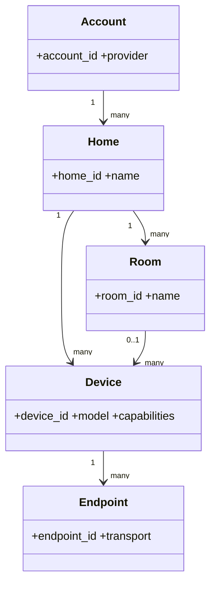

# Discovery and identity

## Canonical hierarchy

## Identifier rules

- `account_id`, `home_id` and `device_id` must derive from immutable upstream identifiers.
- Serial number may be used only when the vendor guarantees uniqueness and stability.
- MAC addresses are normalized and never used as user-facing names.
- Room reassignment must not change entity unique IDs.
- Adapter or transport migration must preserve the canonical device identity where equivalence is proven.

## Discovery modes

| Mode | Use |
|---|---|
| Cloud inventory | account-scoped products and homes |
| Local gateway | MyHOME or LAN-capable bridges |
| Zeroconf/SSDP | discovery hint, not identity authority |
| Manual endpoint | recovery or unsupported discovery environments |

Current BTDoor Security+ configuration is handled by the existing config flow. The broader hierarchy is an architecture contract for future adapters.
